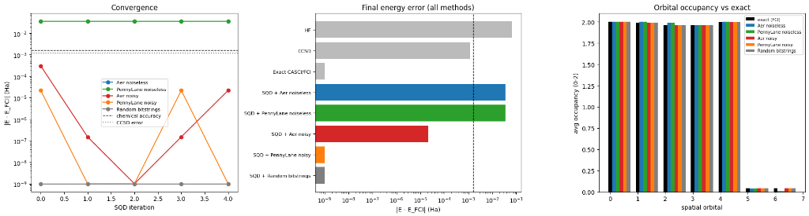
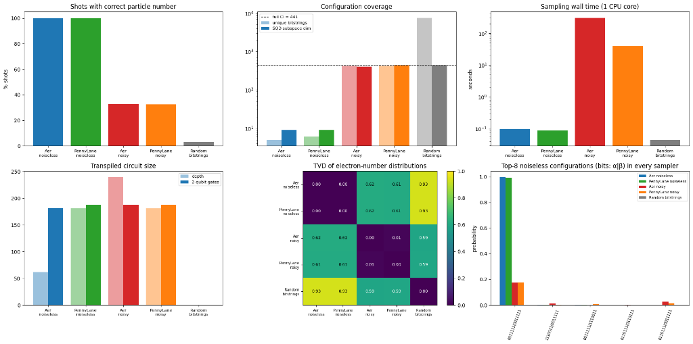

# ⚛️ SQD for N₂ — Quantum Chemistry Benchmark

> **Sample-based Quantum Diagonalization (SQD)** applied to the N₂ molecule active space,  
> comparing classical references, Qiskit Aer, and PennyLane samplers (noiseless, noisy, and random control).

[](https://python.org)
[](https://qiskit.org)
[](https://pennylane.ai)
[](LICENSE)

---

## 📖 Overview

This project benchmarks **Sample-based Quantum Diagonalization (SQD)** using the [`qiskit-addon-sqd`](https://github.com/Qiskit/qiskit-addon-sqd) solver on the **N₂ molecule** active space (CAS(6e,6o)), and compares five sampling strategies:

| Sampler | Backend | Noise |
|---|---|---|
| Aer noiseless | `qiskit-aer` | None |
| PennyLane noiseless | `lightning.qubit` | None |
| Aer noisy | `qiskit-aer` + `FakeSherbrooke` | Full device noise model |
| PennyLane noisy | `lightning.qubit` + Pauli trajectory | Avg. error rates from FakeSherbrooke |
| Random bitstrings | No circuit | None (control) |

All five samplers feed the **same** SQD solver on the **same** N₂ active space — energies are directly comparable.

Classical references (HF, CCSD, exact FCI via PySCF) are included for context.

---

## 🏆 Key Results

### Energy Summary

| Method | Energy (Ha) | Error vs FCI (Ha) | Error (mHa) | Within chemical accuracy (1.6 mHa) |
|---|---|---|---|---|
| HF | -108.835237 | 6.60e-02 | 65.951 | ❌ No |
| CCSD | -108.900003 | 1.18e-03 | 1.184 | ✅ Yes |
| **Exact CASCI/FCI** | **-108.901187** | **0.00e+00** | **0.000** | ✅ Yes |
| SQD + Aer noiseless | -108.866422 | 3.48e-02 | 34.765 | ❌ No |
| SQD + PennyLane noiseless | -108.866422 | 3.48e-02 | 34.765 | ❌ No |
| SQD + Aer noisy | -108.901166 | 2.17e-05 | 0.022 | ✅ Yes |
| SQD + PennyLane noisy | -108.901187 | 1.08e-10 | 0.000 | ✅ Yes |
| SQD + Random bitstrings | -108.901187 | 1.08e-10 | 0.000 | ✅ Yes |

> **Key insight:** Noisy samplers *outperform* noiseless ones — noise diversifies the bitstring distribution, expanding the SQD subspace to cover the full FCI space (441 configurations), whereas noiseless circuits collapse to only 5–6 unique bitstrings.

### Sampling Statistics

| Sampler | Shots | Circuit depth | 2q gates | Sampling time (s) | Valid-particle-number shots | Unique bitstrings | Unique valid | SQD subspace dim (full CI = 441) |
|---|---|---|---|---|---|---|---|---|
| Aer noiseless | 10,000 | 62 | 182 | 0.10 | 100.0% | 5 | 5 | 9 |
| PennyLane noiseless | 10,000 | 181 | 188 | 0.09 | 100.0% | 6 | 6 | 9 |
| Aer noisy | 1,000 | 239 | 188 | 302.08 | 32.9% | 421 | 50 | 400 |
| PennyLane noisy | 1,000 | 181 | 188 | 39.19 | 32.4% | 417 | 52 | 441 |
| Random bitstrings | 10,000 | 0 | 0 | 0.05 | 3.0% | 7,509 | 214 | 441 |

### SQD Convergence per Iteration

| SQD iteration | Aer noiseless | PennyLane noiseless | Aer noisy | PennyLane noisy | Random bitstrings |
|---|---|---|---|---|---|
| 0 | 3.48e-02 | 3.48e-02 | 3.00e-04 | 2.17e-05 | 1.08e-10 |
| 1 | 3.48e-02 | 3.48e-02 | 1.50e-07 | 1.08e-10 | 1.08e-10 |
| 2 | 3.48e-02 | 3.48e-02 | 1.08e-10 | 1.08e-10 | 1.08e-10 |
| 3 | 3.48e-02 | 3.48e-02 | 1.50e-07 | 2.17e-05 | 1.08e-10 |
| 4 | 3.48e-02 | 3.48e-02 | 2.17e-05 | 1.08e-10 | 1.08e-10 |

### Distribution Comparison (TVD)

- **Noiseless Aer vs PennyLane**, TVD over full bitstring distributions: **0.002**  
  *(should be ~0: same physics, shot noise only)*
- **Noisy Aer vs PennyLane**, TVD of electron-number distributions: **0.045**  
  *(different noise models — expected deviation)*

---

## 📊 Figures

### Energy Convergence & Final Comparison



*Left: SQD energy error vs. iteration for each sampler. Middle: Final |E − E_FCI| for all methods. Right: Average orbital occupancy compared to FCI.*

### Sampling & Distribution Analysis



*Top row: Valid particle-number shots %, configuration coverage, sampling wall time. Bottom row: Transpiled circuit size, TVD heatmap of electron-number distributions, top-8 noiseless configurations.*

---

## 🗂️ Repository Structure

```
.
├── quantum_che.ipynb          # Main Jupyter notebook (all code + outputs)
├── results/
│   ├── figures/
│   │   ├── energy_convergence.png   # Convergence + final energy bar chart + occupancy
│   │   └── sampling_analysis.png    # Shots / circuit / TVD / coverage / timing plots
│   └── summary_table.md             # This README's tables as standalone reference
├── requirements.txt           # Python dependencies
├── LICENSE                    # MIT License
└── README.md                  # This file
```

---

## 🚀 Getting Started

### Prerequisites

- Python 3.10+
- Linux or macOS recommended (PySCF does not natively support Windows)
- For GPU acceleration: CUDA-enabled GPU (optional)

### Installation

```bash
git clone https://github.com/aravindp1807/quantum-.git
cd quantum-
pip install -r requirements.txt
```

### Running the Notebook

```bash
jupyter notebook quantum_che.ipynb
```

Or open in [Google Colab](https://colab.research.google.com/) — the first cell handles all installation automatically.

---

## 📦 Dependencies

| Package | Purpose |
|---|---|
| `pyscf` | Classical quantum chemistry (HF, CCSD, FCI) |
| `ffsim` | Fermionic state vector simulation |
| `qiskit` | Quantum circuit construction |
| `qiskit-aer` | Aer simulator (noiseless + noisy with `FakeSherbrooke`) |
| `qiskit-ibm-runtime` | IBM Quantum access + transpilation |
| `qiskit-addon-sqd` | SQD solver |
| `pennylane` | Alternate quantum backend |
| `pennylane-lightning` | Fast `lightning.qubit` execution |
| `matplotlib` | Plotting |
| `pandas` | Tabular analysis |
| `numpy`, `scipy` | Numerical core |

---

## 🔬 Scientific Background

**Sample-based Quantum Diagonalization (SQD)** is a hybrid classical-quantum algorithm:
1. A quantum circuit (or sampler) produces a set of bitstrings representing electronic configurations.
2. The bitstrings define a subspace of the full configuration-interaction (FCI) Hilbert space.
3. A classical FCI solver diagonalizes the Hamiltonian restricted to that subspace.
4. The process iterates, refining the subspace using the dominant configurations from the previous step.

The N₂ active space used here is **CAS(6e, 6o)** — 6 electrons in 6 orbitals — with a full FCI dimension of **441** Slater determinants.

### Why does noise help?

Noiseless circuits are **highly deterministic**: they reproduce only 5–6 unique bitstrings, spanning a 9-dimensional subspace (<<441). The SQD solver is starved of configurations.

Noisy circuits and random bitstrings introduce **diversity**, filling the subspace up to 400–441 dimensions and enabling the solver to find the true FCI ground state within chemical accuracy (< 1.6 mHa).

---

## 📐 Methodology

| Step | Detail |
|---|---|
| Molecule | N₂, bond length 1.098 Å, cc-pVDZ basis |
| Active space | CAS(6e, 6o), full FCI dim = 441 |
| Reference methods | RHF → CCSD → FCI (PySCF) |
| Circuit | LUCJ ansatz transpiled for IBM 127-qubit topology |
| Noise model (Aer) | `FakeSherbrooke` full device model |
| Noise model (PL) | Depolarizing + readout, avg. rates from FakeSherbrooke |
| SQD iterations | 5 |
| Shots (noiseless) | 10,000 |
| Shots (noisy) | 1,000 |
| Chemical accuracy | 1.6 mHa (≈ 1 kcal/mol) |

---

## 📄 License

This project is licensed under the **MIT License** — see [LICENSE](LICENSE) for details.

---
